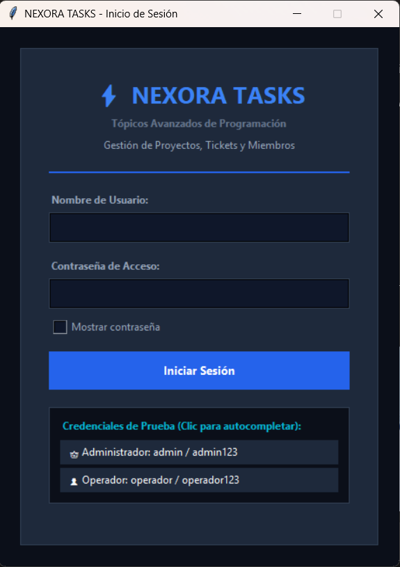
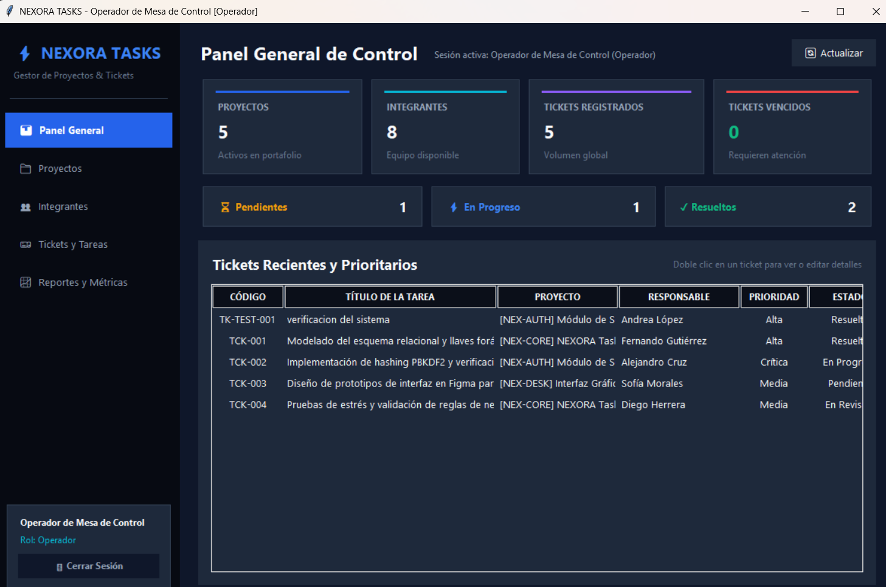
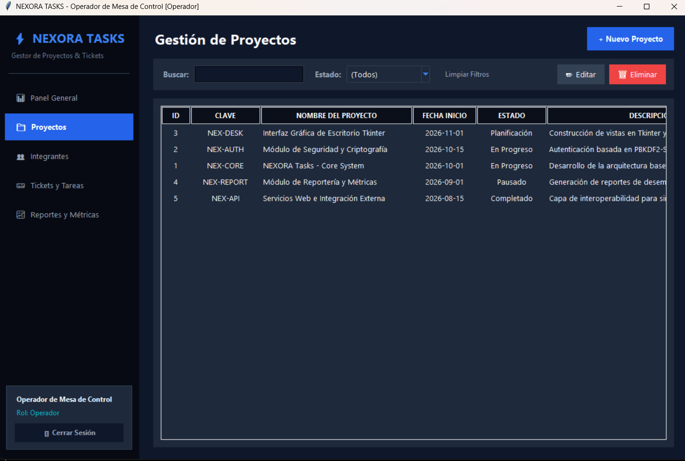
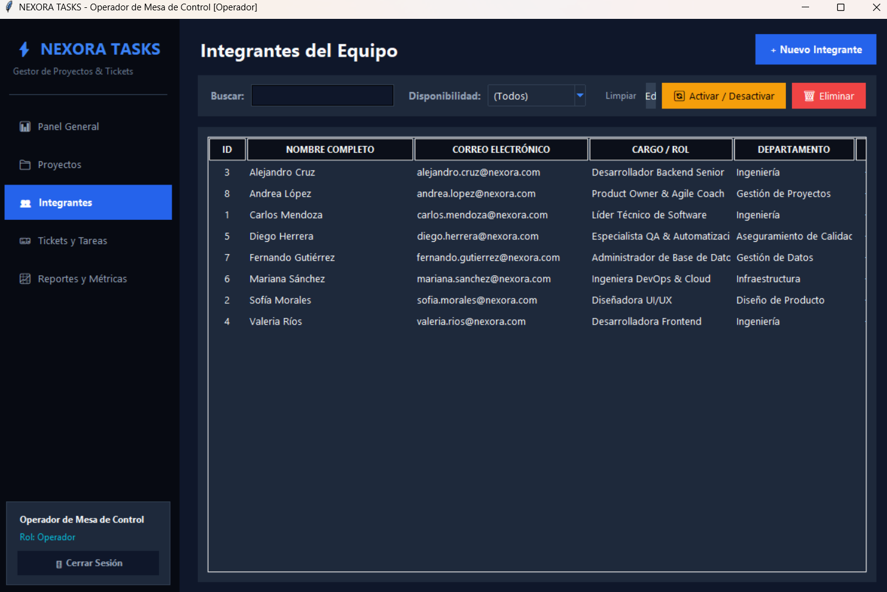
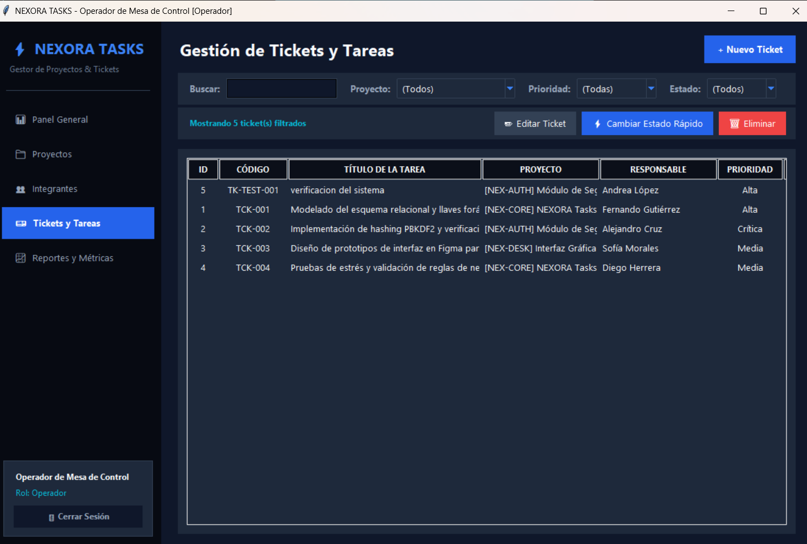
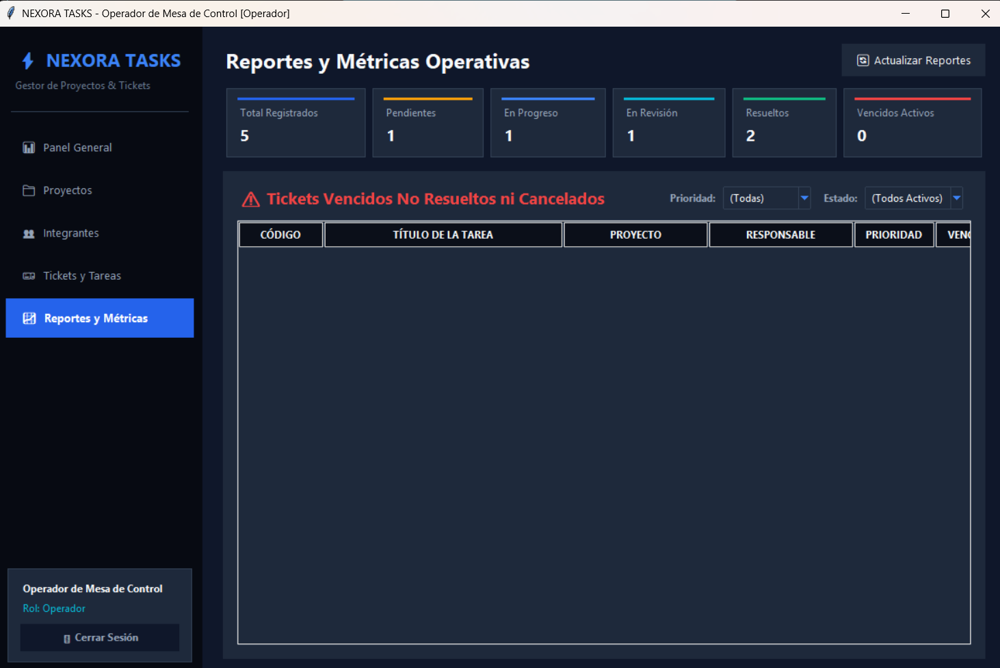

# NEXORA TASKS
## Sistema de Gestión de Proyectos y Tickets

**Proyecto académico desarrollado para la asignatura Tópicos Avanzados de Programación.**

NEXORA TASKS es una aplicación de escritorio desarrollada con **Python 3.10 o superior**, **SQLite3** y **Tkinter/ttk**, diseñada para facilitar la administración de proyectos, integrantes, tareas y cuentas de acceso mediante una interfaz gráfica.

El sistema implementa programación orientada a objetos y una arquitectura organizada en capas, separando la presentación, las reglas de negocio, el acceso a datos y la persistencia.

---

## 1. Características principales

- Autenticación de usuarios con contraseñas protegidas criptográficamente.
- Administración de proyectos.
- Registro y gestión de integrantes.
- Creación, asignación y seguimiento de tickets.
- Control de prioridades y fechas límite.
- Panel general con indicadores de actividad.
- Reportes y métricas.
- Control de acceso según roles de usuario.
- Validaciones para proteger la integridad de la información.
- Persistencia de datos mediante SQLite3.

## 2. Arquitectura del sistema

El proyecto utiliza una arquitectura por capas para facilitar el mantenimiento, la organización y la separación de responsabilidades.

```text
NEXORA-TASK/
│
├── assets/                 # Recursos visuales
├── database/               # Administración de SQLite
├── docs/                   # Documentación y evidencias
│   └── capturas/           # Capturas de pantalla
├── models/                 # Entidades del sistema
├── repositories/           # Acceso y consultas a datos
├── services/               # Lógica y reglas de negocio
├── ui/                     # Interfaz gráfica
│   ├── components/         # Componentes y ventanas modales
│   └── views/              # Vistas de la aplicación
│
├── main.py                 # Punto de entrada
├── test_db.py              # Pruebas de base de datos
├── test_ui.py              # Pruebas de interfaz gráfica
├── requirements.txt        # Dependencias opcionales
├── README.md               # Documentación principal
└── .gitignore              # Archivos excluidos de Git
```

### Descripción de las capas

1. **Models:** contiene las entidades principales: `User`, `Member`, `Project` y `Ticket`.
2. **Database:** administra las conexiones SQLite, la creación de tablas, las restricciones relacionales y los datos iniciales.
3. **Repositories:** concentra las operaciones SQL y las consultas de persistencia mediante el patrón Repository.
4. **Services:** implementa las reglas de negocio, validaciones, autenticación, seguridad y gestión de proyectos, integrantes y tickets.
5. **UI:** contiene las ventanas, vistas, componentes visuales y formularios modales.
6. **Assets:** almacena los recursos visuales.
7. **Docs:** contiene la documentación y las evidencias de funcionamiento.

## 3. Tecnologías utilizadas

| Tecnología | Aplicación |
|---|---|
| Python 3.10+ | Lenguaje principal |
| SQLite3 | Base de datos relacional |
| Tkinter | Interfaz gráfica |
| ttk | Componentes visuales |
| hashlib | Derivación criptográfica de contraseñas |
| secrets | Generación de sales criptográficas |
| hmac | Comparación segura de hashes |
| dataclasses | Modelos de datos |
| Git y GitHub | Control de versiones |

El proyecto utiliza principalmente módulos incluidos en la biblioteca estándar de Python.

No se requieren dependencias externas de terceros para la ejecución básica de la aplicación.

## 4. Modelo de base de datos

El sistema utiliza SQLite3 para almacenar la información y mantener la integridad referencial mediante claves primarias, claves foráneas y restricciones.

### 4.1 Tabla `users_system`

Almacena las cuentas de acceso.

| Campo | Descripción |
|---|---|
| id | Identificador principal |
| username | Nombre de usuario único |
| password_hash | Hash de contraseña |
| salt | Sal criptográfica |
| full_name | Nombre completo |
| role | Administrador u Operador |
| is_active | Estado de la cuenta |
| created_at | Fecha de creación |

### 4.2 Tabla `members`

Almacena los integrantes que pueden participar en los proyectos.

| Campo | Descripción |
|---|---|
| id | Identificador principal |
| full_name | Nombre completo |
| email | Correo electrónico único |
| role_title | Cargo o puesto |
| department | Departamento |
| phone | Teléfono opcional |
| is_active | Disponibilidad del integrante |
| created_at | Fecha de registro |

### 4.3 Tabla `projects`

Almacena los proyectos registrados.

| Campo | Descripción |
|---|---|
| id | Identificador principal |
| code | Código único |
| name | Nombre del proyecto |
| description | Descripción |
| start_date | Fecha de inicio |
| status | Estado del proyecto |
| created_at | Fecha de registro |

Estados disponibles:

- Planificación
- En Progreso
- Pausado
- Completado
- Cancelado

### 4.4 Tabla `tickets`

Almacena las tareas e incidencias relacionadas con proyectos.

| Campo | Descripción |
|---|---|
| id | Identificador principal |
| ticket_code | Código único del ticket |
| title | Título |
| description | Descripción |
| project_id | Proyecto relacionado |
| assigned_member_id | Integrante asignado |
| priority | Prioridad |
| due_date | Fecha límite |
| status | Estado de la tarea |
| created_at | Fecha de creación |
| updated_at | Fecha de actualización |

Prioridades disponibles:

- Baja
- Media
- Alta
- Crítica

Estados disponibles:

- Pendiente
- En Progreso
- En Revisión
- Resuelto
- Cancelado
- Cerrado

### 4.5 Relaciones principales

- Un proyecto puede tener múltiples tickets.
- Un ticket debe pertenecer a un proyecto.
- Un integrante puede tener múltiples tickets asignados.
- Un ticket puede permanecer sin integrante asignado.

Se utilizan restricciones de claves foráneas para proteger la integridad de los datos.

## 5. Reglas de negocio e integridad

### 5.1 Protección contra eliminación de proyectos

El sistema incorpora una regla para evitar la pérdida accidental de información:

1. No permite eliminar proyectos que tengan tickets activos.
2. Se consideran activos los tickets en estado Pendiente, En Progreso y En Revisión.
3. La validación se realiza desde `ProjectService`.
4. Si existen tickets activos, se bloquea la eliminación y se informa al usuario.
5. Si no existen tickets activos, se requiere confirmación explícita antes de eliminar.
6. La restricción `ON DELETE RESTRICT` protege también la integridad desde SQLite.

### 5.2 Otras reglas implementadas

- Los nombres de usuario no pueden duplicarse.
- Los correos electrónicos de integrantes deben ser únicos.
- No se permite asignar tickets a integrantes inactivos.
- No se permite crear tickets en proyectos cerrados o completados.
- Los permisos de acceso dependen del rol de la cuenta.
- La eliminación de integrantes conserva los tickets mediante la relación `ON DELETE SET NULL`.

## 6. Seguridad y autenticación

El sistema implementa un mecanismo de protección de contraseñas mediante:

- PBKDF2 con HMAC-SHA256.
- 100,000 iteraciones de derivación.
- Sales criptográficas individuales de 16 bytes.
- Generación de sales mediante `secrets.token_hex(16)`.
- Comparación de hashes mediante `hmac.compare_digest()`.

Las contraseñas no se almacenan directamente en texto plano.

## 7. Usuarios de prueba

El sistema incluye cuentas iniciales para probar los diferentes niveles de acceso.

| Rol | Usuario | Contraseña |
|---|---|---|
| Administrador | `admin` | `admin123` |
| Operador | `operador` | `operador123` |

### Administrador

- Acceso a los módulos autorizados para administración.
- Gestión de proyectos.
- Gestión de integrantes.
- Gestión de tickets.
- Consulta de reportes.
- Administración de cuentas de acceso.

### Operador

- Acceso al panel general.
- Acceso a los módulos de proyectos, integrantes y tickets.
- Consulta de reportes.
- Sin acceso al módulo de cuentas de usuario.

> Las credenciales anteriores son exclusivamente para pruebas académicas. Se recomienda cambiarlas antes de utilizar el sistema en un entorno real.

## 8. Módulos de la interfaz gráfica

### 8.1 Inicio de sesión

- Validación de credenciales.
- Verificación criptográfica de contraseñas.
- Opción para mostrar u ocultar la contraseña.
- Acceso mediante perfiles de prueba.

### 8.2 Panel general (Dashboard)

- Indicadores generales.
- Conteo de tickets por estado.
- Resumen de actividad.
- Consulta de tickets prioritarios.

### 8.3 Gestión de proyectos

- Registro de proyectos.
- Edición de información.
- Consulta y búsqueda.
- Filtros por estado.
- Eliminación protegida mediante reglas de negocio.

### 8.4 Gestión de integrantes

- Registro de integrantes.
- Edición de información.
- Consulta de integrantes.
- Activación y desactivación.
- Validación de correos electrónicos únicos.

### 8.5 Gestión de tickets y tareas

- Creación y edición de tickets.
- Asignación de proyectos e integrantes.
- Administración de prioridades.
- Control de fechas límite.
- Actualización de estados.
- Consulta de información relacionada.

### 8.6 Reportes y métricas

- Consulta de tickets vencidos.
- Indicadores de actividad.
- Resumen por estados.
- Filtros por prioridad y estado.

### 8.7 Cuentas de acceso

Módulo exclusivo del administrador.

- Consulta de usuarios.
- Creación de cuentas.
- Asignación de roles.
- Desactivación de cuentas.
- Restablecimiento de contraseñas.

## 9. Instalación y ejecución

### 9.1 Requisitos del sistema

- Python 3.10 o superior.
- Tkinter disponible en la instalación de Python.
- SQLite3 disponible.
- Sistema operativo Windows, Linux o macOS con soporte para Tkinter.

### 9.2 Clonar el repositorio

```bash
git clone https://github.com/missaelortiz-wq/NEXORA-TASK.git
```

Entrar en la carpeta:

```bash
cd NEXORA-TASK
```

### 9.3 Preparar el entorno virtual (opcional)

En Windows:

```powershell
py -m venv .venv
.venv\Scripts\activate
```

### 9.4 Instalar dependencias opcionales

La aplicación no necesita paquetes externos para su ejecución básica.

El archivo `requirements.txt` incluye pytest como herramienta opcional:

```powershell
py -m pip install -r requirements.txt
```

### 9.5 Ejecutar la aplicación

En Windows:

```powershell
py main.py
```

También se puede utilizar:

```bash
python main.py
```

La aplicación inicializa la base de datos y abre la ventana de inicio de sesión.

## 10. Validación y pruebas automatizadas

El proyecto cuenta con dos suites de pruebas automatizadas desarrolladas directamente en Python mediante verificaciones con `assert`.

No se requiere pytest para ejecutar directamente estos scripts.

### 10.1 Pruebas de base de datos y reglas de negocio

Ejecutar:

```powershell
py test_db.py
```

Se verifican 13 condiciones:

1. Activación de claves foráneas en SQLite.
2. Rechazo de tickets con proyectos inexistentes.
3. Restricción CHECK para roles no permitidos.
4. Rechazo de nombres de usuario duplicados.
5. Protección contra eliminación de proyectos con tickets activos.
6. Confirmación explícita para eliminar proyectos.
7. Eliminación autorizada de proyectos sin tickets activos.
8. Restricción de borrado mediante `ON DELETE RESTRICT`.
9. Desasignación de integrantes mediante `ON DELETE SET NULL`.
10. Generación y verificación segura de contraseñas mediante PBKDF2.
11. Bloqueo de creación de tickets en proyectos cerrados o completados.
12. Bloqueo de asignaciones a integrantes inactivos.
13. Restricción de gestión de cuentas para el rol Operador.

**Resultado registrado durante el desarrollo: 13 de 13 pruebas aprobadas.**

### 10.2 Pruebas de interfaz gráfica

Ejecutar:

```powershell
py test_ui.py
```

Esta suite verifica la inicialización y navegación de los componentes principales de Tkinter/ttk.

Se comprueban:

- Inicialización de `LoginWindow`.
- Autenticación mediante `AuthService`.
- Inicialización de `MainWindow` con perfil Administrador.
- Navegación por los seis módulos del administrador.
- Inicialización de `ProjectModal`.
- Inicialización de `MemberModal`.
- Inicialización de `TicketModal`.
- Inicialización de `UserModal`.
- Inicialización de `PasswordResetModal`.
- Acceso del perfil Operador a los módulos autorizados.
- Restricción del módulo de cuentas para el perfil Operador.

**Resultado registrado durante el desarrollo: pruebas de interfaz completadas satisfactoriamente.**

> Las pruebas de interfaz requieren un entorno gráfico compatible con Tkinter.

## 11. Evidencias del proyecto

A continuación se presentan las capturas de pantalla correspondientes al funcionamiento de NEXORA TASKS.

### 11.1 Inicio de sesión



### 11.2 Panel general



### 11.3 Gestión de proyectos



### 11.4 Gestión de integrantes



### 11.5 Gestión de tickets



### 11.6 Reportes y métricas



Las evidencias también se encuentran almacenadas en el directorio `docs/capturas/` del repositorio.

## 12. Información académica

| Información | Descripción |
|---|---|
| Proyecto | NEXORA TASKS |
| Asignatura | Tópicos Avanzados de Programación |
| Tipo | Aplicación de escritorio |
| Lenguaje | Python |
| Base de datos | SQLite3 |
| Interfaz gráfica | Tkinter/ttk |
| Repositorio | [NEXORA TASKS en GitHub](https://github.com/missaelortiz-wq/NEXORA-TASK) |

## 13. Conclusión

NEXORA TASKS integra conceptos de programación orientada a objetos, arquitectura por capas, persistencia relacional, consultas SQL, autenticación segura, control de permisos y desarrollo de interfaces gráficas.

El proyecto implementa operaciones de gestión de proyectos, integrantes y tickets, así como reglas de negocio destinadas a proteger la integridad de la información.

Las suites automatizadas permiten verificar el comportamiento de los principales componentes del sistema, incluyendo la base de datos, las reglas de negocio y la interfaz gráfica.

**NEXORA TASKS — Gestión organizada, segura y eficiente de proyectos y tareas.**